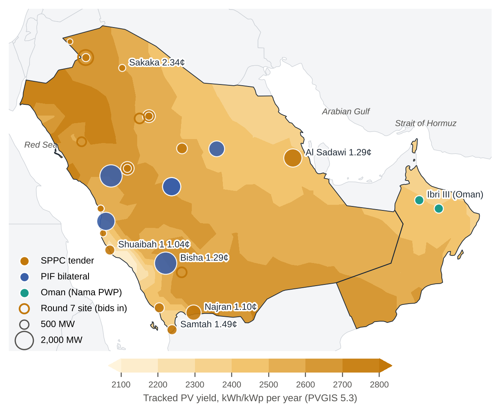
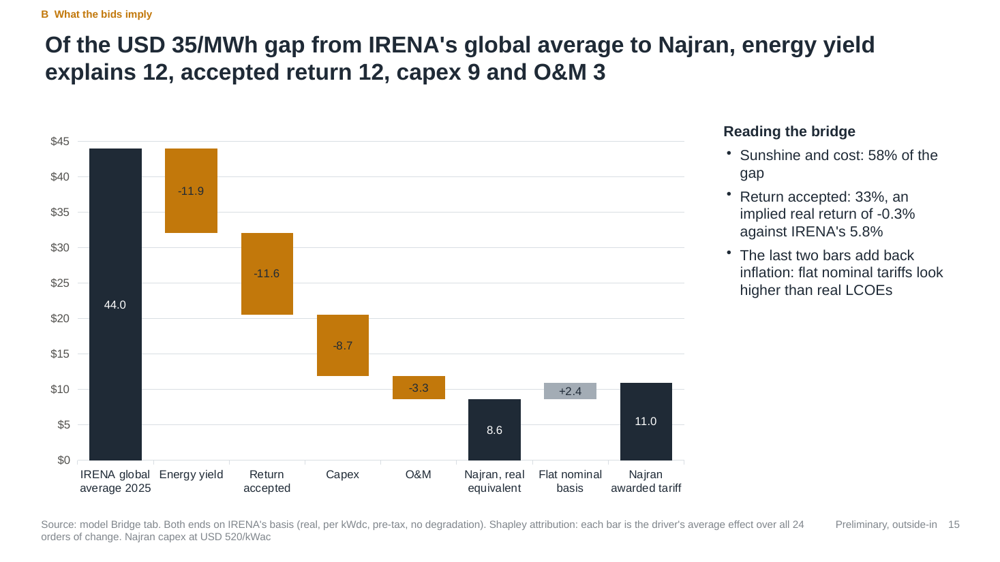

# Saudi solar tariffs: what drives a 1.1 ¢/kWh bid, and can Oman match it?

An outside-in case on public data. A Gulf utility (Oman's single buyer, Nama PWP) wants to know whether Saudi Arabia's record solar tariffs are replicable in its market: what drives a bid of about 1.1 US cents per kWh, and how sensitive is it to capital cost, capacity factor and financing?

## The answer

- **The record is real, but a tariff is not a cost.** Masdar won Najran (1.4 GW, October 2025) at 1.09682 ¢/kWh. Restated as a constant real price that is 0.86 ¢. IRENA's own 2025 average cost for Saudi solar is 4.0 ¢ and its global average is 4.4 ¢.
- **Saudi Arabia gets a bargain.** The 17.8 GW of solar now running frees about 208 kb/d of crude, 47% of 2025 direct burn. At a USD 86 Brent that oil is worth USD 6.3bn a year, against USD 0.74bn of tariffs: 8.5 dollars of oil for every dollar paid.
- **About 60% of the gap is sunshine and cost, about a third is the return sponsors accept.** At the 2025 disclosed cost of USD 510/kWac, Najran returns 1.1% a year before leverage, below a 5.25% cost of debt. Bridging IRENA's USD 44/MWh to Najran's USD 8.6 (real), energy yield explains USD 12, accepted return 12, capex 9 and O&M 3.
- **The bid barely covers the cost of building and running the plant.** Najran costs about 1.00 ¢ before any return. The 1.10 ¢ bid leaves 0.09 ¢ for lenders, equity and tax, against 0.65 ¢ at a commercial hurdle. Even a 35-year life at a 3% WACC supports only USD 476/kWac, so the true build cost must be lower than disclosed or the sponsor earns elsewhere.
- **Oman can copy the design, not the returns, and still beat gas.** Oman has bought 2 GW of solar so far, in 500 MW lots on 15 to 20-year PPAs, from ACWA Power, EDF and KOWEPO, Sembcorp and Masdar. At commercial returns a 500 MW plant at Ibri needs about 2.35 ¢. Credit support, GW-scale tenders and 25-year PPAs bring that to about 1.83 ¢, worth about USD 122m a year on the solar in Nama PWP's 2031 plan. Both sit below the 2.9 ¢ fuel cost of gas-fired power at Oman's regulated gas price, and well below the 5.5 ¢ value of that gas exported as LNG. Oman's gas price is not published, but solar wins as long as gas costs more than USD 3.4/MMBtu (USD 2.6 with the design moves).

## Prediction: Saudi Round 7 (made 19 November 2026)

Round 7 bids for four PV sites closed on 13 September 2026, and SPPC has not announced the winners. If the winners accept the same returns Round 6 winners did, at the 2025 disclosed cost, the model expects these tariffs (US cents per kWh):

| Site | Region | MWac | Energy kWh/kWac | At Najran's return (1.1%) | At the Round 6 average (2.2%) | At the highest Round 6 return (4.2%) |
|---|---|---|---|---|---|---|
| Tabarjal II | Al Jouf | 1,400 | 3,181 | 1.12 | 1.23 | 1.46 |
| Mawqaq | Hail | 600 | 3,149 | 1.13 | 1.24 | 1.48 |
| Tathleeth | Aseer | 600 | 3,212 | 1.11 | 1.22 | 1.45 |
| South Al Ula | Madinah | 500 | 3,124 | 1.14 | 1.25 | 1.49 |

Weighted by capacity, the central case is 1.23 ¢. Awards above the range would mean costs rose or bidders wanted more; awards below it would mean sponsors accepted less than they did at Najran. The `Forecast` tab holds the calculation, and a model check confirms that the same formula reproduces Najran's own tariff.





## What is here

| Path | What it is |
|---|---|
| `model/NREP_Tariff_LCOE_Model.xlsx` | The model. 18 tabs, live formulas, no macros. Start on the Cover tab |
| `deck/NREP_Tariff_Replicability.pptx` and `.pdf` | 28 slides: 22 in three sections (what Saudi Arabia built, what the bids imply, what Oman can copy) plus a 6-slide appendix. Every number is read from the model |
| `onepager/NREP_onepager.pdf` | One-page summary |
| `docs/model-guide.md` | Tab-by-tab and formula-by-formula walkthrough, with a worked Najran example |
| `docs/map.png` | Resource map: PVGIS tracked yield on a 1° grid with awarded projects and Round 7 sites |
| `data/tracker.csv` | 43 rows: Saudi PV awards of 200 MW and above since 2018 from both buying tracks, with lead sponsor; the four Round 7 sites; Oman's four solar IPPs; UAE and Qatar comparators |
| `data/capex_evidence.csv` | Disclosed project costs from ACWA Power and Masdar filings |
| `data/assumptions.csv` | 70 inputs, each tagged Reported, Derived or Assumed, with a low and high value and a source |
| `data/sources.csv` | 63 sources with URLs and access dates |
| `data/milestones.csv`, `data/value_chain.csv`, `data/rates.csv` | Project milestones, named value-chain participants, US 10-year rates |
| `data/yield.csv`, `data/yield_grid.csv`, `data/raw/` | PVGIS site and grid yields and the raw API responses they came from |
| `src/nrep/` | Python that fetches public data, builds the workbook, map and deck, and checks them |
| `tests/` | 25 tests, including a check that every workbook output matches an independent calculation |

## Method

1. **Tariffs.** Each award is taken from the buyer's announcement as reported by the trade press or the winning developer, in US cents and, where published, halalas. Tariffs that sources disagree on, or that were never published, stay in the tracker but out of the analysis.
2. **Sunshine.** PVGIS 5.3 gives the yield of a single-axis tracker at each site and on a 1° grid for the map. One factor converts that to delivered AC energy per kWac. It is calibrated on Sakaka, a 300 MWac tracker plant whose 2022 output (932 GWh) GASTAT publishes.
3. **Cost.** Four views of capex: disclosed total investment per project (ACWA Power's FY2025 investor report, Masdar), IRENA's 2025 Saudi figure, a bottom-up build at October 2026 module prices, and the capex each tariff implies.
4. **Engine.** A closed-form after-tax levelised cost for every award gives the capex at which the tariff earns a 5.8% hurdle WACC, the project return at the disclosed cost, and the real-equivalent tariff. A single-asset project finance model adds sculpted debt and equity returns.
5. **Attribution.** A Shapley decomposition splits the gap between IRENA's global average and Najran across energy, capex, O&M and return. It averages each driver's effect over every order of change, so no ordering choice is hidden.
6. **Value chain.** Najran's required tariff is split into hardware, EPC and fees, O&M, return on capital and tax, each with named participants. A grid of plant life against WACC shows what has to be true for the bid to reach the disclosed cost.
7. **Impact.** Solar output, the heat rate of the oil plant it displaces and the energy in a barrel give crude freed, its value at World Bank Brent prices and the CO2 avoided, set against the tariffs paid.
8. **Oman.** The same engine runs on Ibri's yield, Oman's disclosed Ibri III cost and financing adjusted for Oman's sovereign risk (Damodaran, January 2026). A second Shapley split separates what Oman inherits from what its tender design controls, and Nama PWP's 2031 solar plan turns each cent saved into dollars a year. Dividing each Oman tariff by the gas plant's heat rate gives the gas price at which solar stops winning.
9. **Forecast.** The engine's closed form, run at each Round 7 site's yield and the returns Round 6 winners accepted, gives a dated range for the next awards.

## Limits

- Yield rests on one calibration plant from 2020. Newer bifacial plants at higher DC/AC ratios probably produce more, which would raise the capex each tariff supports by about USD 40/kWac for every 10% of extra energy.
- Disclosed "total investment cost" may include development fees and EPC margins paid to sponsor affiliates. If so, the true build cost is lower and part of the sponsors' return sits outside the project company.
- No value is given to output after the 25-year PPA, except in the what-has-to-be-true grid, which assumes the PPA is extended at the same tariff.
- Debt margin, O&M cost and equity hurdle are assumptions with ranges; no public source gives them for Saudi solar.
- Oil displacement rests on one heat rate and an assumed 80% share of solar output displacing liquids. A saved barrel is valued at export prices; with Hormuz shut in 2026, that depends on room on the Red Sea route.
- Nama PWP does not publish its solar tariffs, so the Oman figures are estimates, not a back-test.
- Round 7 (3.1 GW) bids closed on 13 September 2026 and were unannounced as of 19 November 2026; the forecast above will be checked against the awards. South Al Ula's exact site is not published, so its yield uses open ground south of the town.

## Rebuild

Needs Python 3.12+ with `uv`, and LibreOffice for recalculation and PDF export.

```
make data     # pull PVGIS site and grid yields (and KAPSARC's project list) into data/
make model    # build the workbook and recalculate it
make deck     # draw the map, then build the deck and one-pager from the recalculated workbook
make check    # lint and tests
```

Code is MIT licensed. Data files are compiled from the public sources listed in `data/sources.csv`; cite those sources when reusing figures. Country borders on the map are from Natural Earth (public domain).
